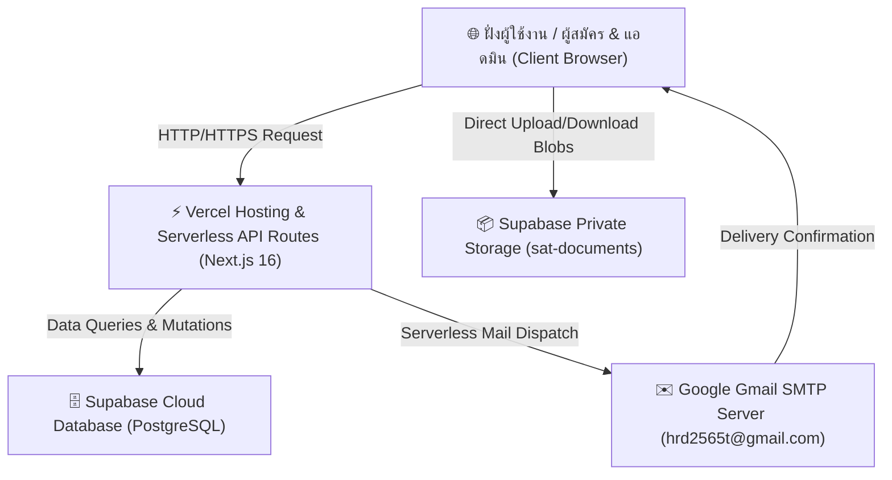
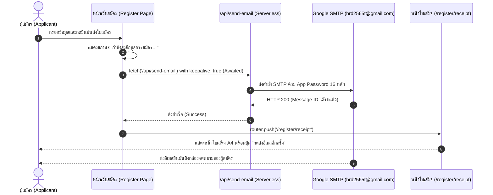

# พิมพ์เขียวสถาปัตยกรรมและการพัฒนาระบบรับสมัคร (System Architecture & Development Blueprint)

> **โครงการ**: ระบบรับสมัครเข้ารับการฝึกอบรมบุคลากรกีฬา  
> **หน่วยงานเจ้าของระบบ**: กองพัฒนาบุคลากรกีฬา ฝ่ายพัฒนากีฬาเป็นเลิศ การกีฬาแห่งประเทศไทย (กกท.)  
> **ที่อยู่ทางการ**: 286 ถนนรามคำแหง แขวงหัวหมาก เขตบางกะปิ กรุงเทพฯ 10240  
> **อีเมลติดต่อทางการ**: `hrd2565t@gmail.com`  
> **เอกสารฉบับนี้จัดทำขึ้นเพื่อ**: เป็นแม่แบบทางเทคนิค สถาปัตยกรรมข้อมูล และคู่มือส่งต่องาน (Handover Specification) สำหรับการพัฒนา บำรุงรักษา หรือโคลนไปสร้างระบบใหม่ในอนาคต

---

## 1. ภาพรวมสถาปัตยกรรมทางเทคนิค (Tech Stack & Architecture)



### รายละเอียดเทคโนโลยีที่เลือกใช้
1. **Frontend & Framework**:
   * **Next.js 16 (App Router)** + **React 19** + **TypeScript**
   * **Tailwind CSS v4**: ควบคุมสไตล์และอัตลักษณ์สีทางการของการกีฬาแห่งประเทศไทย (กกท. Navy Blue `#16265E`, Deep Royal Blue `#1e3a8a`, Emerald Green `#059669`)
2. **Backend & Database**:
   * **Supabase (PostgreSQL 15+)**: Single Source of Truth สำหรับข้อมูลการสมัคร ข้อมูลหลักสูตร และทำเนียบบุคลากร
   * **Supabase Storage (Bucket: `sat-documents`)**: จัดเก็บไฟล์เอกสารแนบจริง (Private Bucket เข้าถึงผ่าน Signed URL หรือ Supabase Client)
3. **Email Notification Engine**:
   * **Nodemailer** เชื่อมต่อ **Gmail SMTP** (`smtp.gmail.com:465`) ด้วย Google App Password (16 หลัก)
   * **Resend API Fallback**: สำรองกรณีส่งผ่าน Resend (ต้องมี Verified Domain)
4. **DevOps & Hosting**:
   * **GitHub Repository**: สำหรับ Version Control และ CI/CD
   * **Vercel Production Platform**: สำหรับ Auto Deploy เมื่อมีการ Push ขึ้นกิ่ง `main`

---

## 2. โครงสร้างฐานข้อมูลและการจัดการไฟล์ (Database & Storage Schema)

### 2.1 ตารางหลักใน Supabase PostgreSQL

#### ตาราง `applications` (ข้อมูลผู้สมัคร)
| ฟิลด์ | ประเภท | คำอธิบาย |
|---|---|---|
| `id` | `bigint (PK, Identity)` | ลำดับตัวเลขภายใน |
| `ref` | `text (Unique, Indexed)` | รหัสอ้างอิง เช่น `SAT-00005` |
| `receipt_no` | `text` | เลขที่ใบรับเรื่อง เช่น `SAT-00005-70` |
| `course_id` | `bigint (FK)` | รหัสหลักสูตรที่สมัคร |
| `course` | `text` | ชื่อย่อหลักสูตร |
| `course_title` | `text` | ชื่อเต็มหลักสูตร |
| `name` | `text` | คำนำหน้า ชื่อ-นามสกุล ผู้สมัคร |
| `id_card` | `text (Indexed)` | เลขประจำตัวประชาชน 13 หลัก (เฉพาะตัวเลข) |
| `phone` | `text` | เบอร์โทรศัพท์ติดต่อ |
| `email` | `text` | อีเมลสำหรับรับแจ้งผลและใบเสร็จ |
| `affiliation` | `text` | สังกัด/หน่วยงาน/สมาคมกีฬา |
| `position` | `text` | ตำแหน่งหน้าที่ |
| `status` | `text` | สถานะ: `pending`, `action_required`, `approved`, `reserve`, `rejected` |
| `reserve_order` | `int` | ลำดับบัญชีสำรอง (ถ้ามี) |
| `review_reason` | `text` | เหตุผลการพิจารณา / ข้อความขอเอกสารเพิ่ม |
| `reviewed_at` | `timestamptz` | วันเวลาที่พิจารณา |
| `reviewed_by` | `text` | ผู้พิจารณา (เช่น กองพัฒนาบุคลากรกีฬา) |
| `file_size` | `bigint` | ขนาดไฟล์รวมทั้งหมดในหน่วย Bytes |
| `ai` | `jsonb` | ผลการคัดกรองเบื้องต้น เช่น `{ tone: "review", line1: "รอการตรวจสอบ", line2: "..." }` |
| `submitted_at` | `timestamptz` | วันเวลาที่ยื่นใบสมัคร |
| `updated_at` | `timestamptz` | วันเวลาที่อัปเดตล่าสุด |

#### ตาราง `application_documents` (เอกสารแนบของผู้สมัคร)
| ฟิลด์ | ประเภท | คำอธิบาย |
|---|---|---|
| `id` | `text (PK)` | รหัสเอกสาร เช่น `photo-1731420000-0` |
| `application_ref` | `text (FK)` | เชื่อมกับ `applications.ref` |
| `kind` | `text` | ประเภท: `photo`, `cover`, `certificate`, `idcard`, `saka` |
| `name` | `text` | ชื่อไฟล์ดั้งเดิม |
| `file_size` | `text` | ขนาดไฟล์แสดงผล เช่น `"40 KB"`, `"1.5 MB"` |
| `file_type` | `text` | MIME type เช่น `image/jpeg`, `application/pdf` |
| `storage_path` | `text` | Path บน Supabase Storage เช่น `applications/SAT-00005/photo.jpg` |
| `data_url` | `text` | ลิงก์ดาวน์โหลดหรือ Base64 สำหรับแสดงผล |

#### ตาราง `courses` (ข้อมูลหลักสูตรและการตั้งค่า)
* เก็บเป้าหมาย 5 กลุ่มเป้าหมาย (`target_quotas`)
* วัตถุประสงค์ คุณสมบัติ เกณฑ์การสำเร็จ
* **การตั้งค่าเอกสารแนบ (`document_config`)**: กำหนดว่าแต่ละหลักสูตรเปิดรับเอกสารอะไรบ้าง และเอกสารใดบังคับ (`required: true`)

---

## 3. สถาปัตยกรรมระบบส่งอีเมลอัตโนมัติ (Email Notification Engine)

### 3.1 Flow การทำงาน


### 3.2 กฎเหล็กในการส่งอีเมลบน Next.js App Router
1. **ต้อง `await` และใช้ `keepalive: true`**:
   * ในเบราว์เซอร์ หากเรียก `fetch('/api/send-email')` โดยไม่มี `await` แล้วตามด้วย `router.push(...)` ทันที เบราว์เซอร์จะสั่งยกเลิก Network Request กลางคัน (Request Aborted)
   * โค้ดที่ถูกต้อง:
     ```typescript
     const emailPromise = fetch("/api/send-email", {
       method: "POST",
       headers: { "Content-Type": "application/json" },
       keepalive: true,
       body: JSON.stringify(payload),
     });
     // รอสูงสุด 3.5 วินาทีเพื่อให้สัญญาณการส่งออกจากเซิร์ฟเวอร์เสร็จสมบูรณ์
     await Promise.race([emailPromise, new Promise((res) => setTimeout(res, 3500))]);
     router.push(`/register/receipt?ref=${record.ref}`);
     ```
2. **การตั้งค่า Gmail SMTP ใน Vercel Environment Variables**:
   * `SMTP_HOST`: `smtp.gmail.com`
   * `SMTP_PORT`: `465`
   * `SMTP_SECURE`: `true`
   * `SMTP_USER`: `hrd2565t@gmail.com`
   * `SMTP_PASS`: `รหัสผ่านสำหรับแอป 16 หลักจาก Google (App Passwords)`

---

## 4. กลไกตรวจสอบเอกสารคุณสมบัติ (Document Audit & Checklist Engine)

### 4.1 ฟังก์ชันหลัก [`lib/document-checklist.ts`](file:///c:/Users/HRD/Desktop/รับสมัคร/lib/document-checklist.ts)
ระบบจะเปรียบเทียบเอกสารที่ผู้สมัครแนบมาจริง กับข้อกำหนดของหลักสูตร (`Course.documentConfig`):

```typescript
export interface DocumentAuditResult {
  items: DocumentCheckItem[];
  requiredCount: number;           // จำนวนเอกสารที่บังคับ
  attachedRequiredCount: number;   // จำนวนเอกสารบังคับที่แนบแล้ว
  missingRequiredCount: number;    // จำนวนเอกสารบังคับที่ยังขาด
  missingRequiredLabels: string[]; // รายชื่อเอกสารที่ยังขาด เช่น ["หนังสือนำส่ง"]
  totalAttachedCount: number;      // จำนวนไฟล์ทั้งหมดที่แนบมา
  status: "complete" | "incomplete" | "none";
}
```

### 4.2 การทำงานในหน้าแอดมิน
1. **หน้าคิวตรวจสอบ (`/admin/review`)**: แสดงป้ายทันที เช่น `✓ เอกสารครบ (3/3)` หรือ `⚠️ ขาดเอกสารบังคับ (2/3): ขาด หนังสือนำส่ง`
2. **หน้ารายละเอียดผู้สมัคร (`/admin/applicants/[ref]`)**:
   * มี **Banner แจ้งเตือนสถานะ** (เขียวเมื่อครบ / ส้มเมื่อขาด)
   * มี **ตาราง Checklist** แสดงสถานะการแนบของแต่ละข้อ พร้อมปุ่มเปิดดูไฟล์จริง
   * **Auto-fill ข้อความขอเอกสารเพิ่ม**: เมื่อกดปุ่ม "ขอเอกสารเพิ่ม" ระบบจะนำชื่อเอกสารที่ขาดไปใส่ในกล่องข้อความให้อัตโนมัติ

---

## 5. การจัดการขนาดไฟล์อัจฉริยะ (Smart File Size Calculation & Formatting)

### 5.1 บทเรียนจากบั๊ก "247 KB กลายเป็น 247 MB"
* หากเอกสารแนบมีขนาด `"40 KB"`, `"170 KB"`, `"37 KB"` ฟังก์ชัน `parseFloat` จะได้เลข `40 + 170 + 37 = 247`
* **ห้ามเติมคำว่า "MB" ต่อท้ายตัวเลขโดยไม่ตรวจสอบหน่วยเด็ดขาด!**
* **ฟังก์ชันแปลงและแสดงผลที่ถูกต้อง ([`lib/applications-store.ts`](file:///c:/Users/HRD/Desktop/รับสมัคร/lib/applications-store.ts))**:
  ```typescript
  export function formatApplicantTotalFileSize(applicant: ApplicantRecord): string {
    let totalBytes = calculateTotalBytes(applicant.documents);
    if (totalBytes < 1024 * 1024) {
      return `${Math.round(totalBytes / 1024)} KB`;
    }
    return `${(totalBytes / (1024 * 1024)).toFixed(1)} MB`;
  }
  ```

---

## 6. กฎเหล็กของระบบ (Non-Negotiable System Rules)

1. **อัตลักษณ์และชื่อหน่วยงานทางการ**:
   * ต้องใช้ชื่อ: **"กองพัฒนาบุคลากรกีฬา ฝ่ายพัฒนากีฬาเป็นเลิศ การกีฬาแห่งประเทศไทย"** เท่านั้น
   * ห้ามใช้ชื่อเดิม "สถาบันพัฒนากีฬาแห่งประเทศไทย" ในทุกหน้าจอ
2. **การคงอยู่ของข้อมูล (Data Persistence)**:
   * ห้าม Hardcode ข้อมูลหลักสูตรมาทับข้อมูลที่แอดมินแก้ไขใน Supabase
3. **การตรวจสอบคุณภาพก่อน Deploy**:
   * ต้องรัน `npx tsc --noEmit` ให้ผ่าน 100% (0 errors) ทุกครั้งก่อน Commit & Push ขึ้น Git

---

## 7. รายการไฟล์สำคัญในระบบ (Directory Index)

| ไฟล์ | หน้าที่สำคัญ |
|---|---|
| `app/register/page.tsx` | ฟอร์มรับสมัครงาน ตรวจสอบเลข ปชช., คำนวณขนาดไฟล์, บีบอัดรูปถ่าย และส่งอีเมล |
| `app/register/receipt/page.tsx` | หน้าใบเสร็จรับเรื่อง พร้อม QR Code และปุ่มกดส่งอีเมลซ้ำ |
| `app/status/page.tsx` | หน้าตรวจสอบสถานะของผู้สมัคร แสดงปุ่มพิมพ์ใบรับการสมัคร (A4) สีเขียวเด่นชัด |
| `app/print/receipt/page.tsx` | เอกสารใบรับเรื่องการสมัคร A4 ทางการสำหรับการพิมพ์หรือบันทึก PDF |
| `app/api/send-email/route.ts` | API Route การส่งอีเมลผ่าน Gmail SMTP และ Resend Fallback |
| `lib/applications-store.ts` | Store ศูนย์กลางการจัดการข้อมูลผู้สมัคร และฟังก์ชันคำนวณขนาดไฟล์ |
| `lib/courses-store.ts` | Store จัดการข้อมูลหลักสูตรและการตัด-คืนที่นั่ง (`seats_left`) |
| `lib/document-checklist.ts` | เอนจินตรวจสอบความครบถ้วนของเอกสารแนบเทียบกับเกณฑ์หลักสูตร |
| `lib/supabase/sync.ts` | เอนจินซิงค์ข้อมูลแบบ Real-time ระหว่าง Client Cache และ Supabase Cloud |
